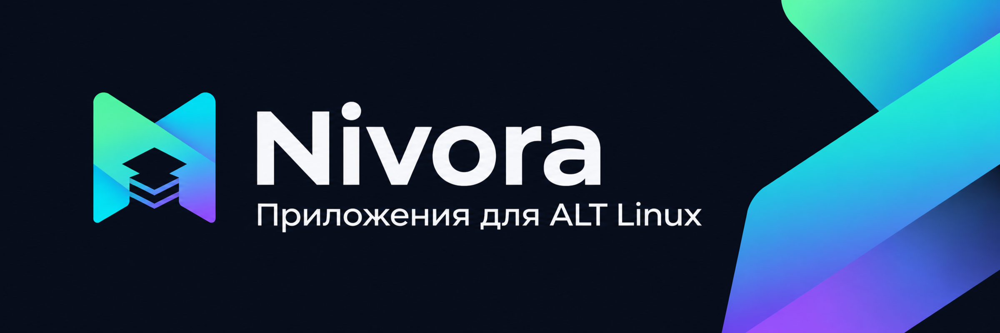
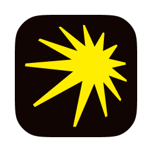

  

  Приложения для <strong>ALT Linux p11</strong> с установкой через Stapler.

  <a href=".github/docs/installation.md">Установка и обновление</a> &nbsp;·&nbsp;
  <a href="#каталог">Каталог</a> &nbsp;·&nbsp;
  <a href=".github/docs/index.md">Документация</a>

<!-- package-count -->

<strong>12 пакетов</strong> &nbsp;·&nbsp; 4 категории

## Каталог

Откройте название приложения, чтобы узнать больше и скопировать команду установки.
Описания основаны на материалах разработчиков; ссылка «Сайт» ведёт к первичному источнику.

<!-- catalog:start -->
<table width="100%">
  <tr>
    <th align="left">Приложение</th>
    <th align="right">Версия</th>
    <th align="left">Архитектуры</th>
    <th align="left">Пакет</th>
  </tr>
  <tr><th colspan="4" align="left">Интернет, сеть и VPN</th></tr>
  <tr><!-- package-card:happ -->
    <td> &nbsp;<a href="happ/README.md"><strong>Happ</strong></a> Прокси-клиент на основе Xray · <a href="https://happ.info/">Сайт</a></td>
    <td align="right" nowrap><code>4.7.2</code></td>
    <td nowrap><code>amd64</code> <code>arm64</code></td>
    <td nowrap><code>nivora/happ</code></td>
  </tr>
  <tr><!-- package-card:tailscale -->
    <td> &nbsp;<a href="tailscale/README.md"><strong>Tailscale</strong></a> Частная сеть между устройствами с WireGuard · <a href="https://tailscale.com/">Сайт</a></td>
    <td align="right" nowrap><code>1.104.7</code></td>
    <td nowrap><code>amd64</code> <code>arm64</code></td>
    <td nowrap><code>nivora/tailscale</code></td>
  </tr>
  <tr><!-- package-card:telegram -->
    <td> &nbsp;<a href="telegram/README.md"><strong>Telegram Desktop</strong></a> Сообщения с синхронизацией между устройствами · <a href="https://desktop.telegram.org/">Сайт</a></td>
    <td align="right" nowrap><code>7.4.4</code></td>
    <td nowrap><code>amd64</code></td>
    <td nowrap><code>nivora/telegram</code></td>
  </tr>
  <tr><th colspan="4" align="left">AI и разработка</th></tr>
  <tr><!-- package-card:antigravity -->
    <td> &nbsp;<a href="antigravity/README.md"><strong>Google Antigravity App</strong></a> Проекты и параллельная работа с ИИ-агентами · <a href="https://antigravity.google/">Сайт</a></td>
    <td align="right" nowrap><code>2.32.1</code></td>
    <td nowrap><code>amd64</code> <code>arm64</code></td>
    <td nowrap><code>nivora/antigravity</code></td>
  </tr>
  <tr><!-- package-card:chatgpt -->
    <td> &nbsp;<a href="chatgpt/README.md"><strong>ChatGPT</strong></a> Чат, файлы и проекты со встроенным Codex · <a href="https://learn.chatgpt.com/docs/app">Сайт</a></td>
    <td align="right" nowrap><code>26.1111.21308</code></td>
    <td nowrap><code>amd64</code> <code>arm64</code></td>
    <td nowrap><code>nivora/chatgpt</code></td>
  </tr>
  <tr><!-- package-card:claude -->
    <td> &nbsp;<a href="claude/README.md"><strong>Claude</strong></a> Приложение Anthropic с чатом, Cowork и Claude Code · <a href="https://code.claude.com/docs/en/desktop-linux">Сайт</a></td>
    <td align="right" nowrap><code>5.11492.5</code></td>
    <td nowrap><code>amd64</code> <code>arm64</code></td>
    <td nowrap><code>nivora/claude</code></td>
  </tr>
  <tr><!-- package-card:opencode -->
    <td> &nbsp;<a href="opencode/README.md"><strong>OpenCode</strong></a> Открытый ИИ-агент для разработки с выбором моделей · <a href="https://opencode.ai/">Сайт</a></td>
    <td align="right" nowrap><code>2.3.0</code></td>
    <td nowrap><code>amd64</code> <code>arm64</code></td>
    <td nowrap><code>nivora/opencode</code></td>
  </tr>
  <tr><th colspan="4" align="left">Медиа и игры</th></tr>
  <tr><!-- package-card:anidesk -->
    <td> &nbsp;<a href="anidesk/README.md"><strong>AniDesk</strong></a> Неофициальный настольный клиент Anixart · <a href="https://github.com/theDesConnet/AniDesk">Сайт</a></td>
    <td align="right" nowrap><code>0.0.1-beta.7</code></td>
    <td nowrap><code>amd64</code></td>
    <td nowrap><code>nivora/anidesk</code></td>
  </tr>
  <tr><!-- package-card:parsec -->
    <td> &nbsp;<a href="parsec/README.md"><strong>Parsec</strong></a> Подключение к удалённому рабочему столу и играм · <a href="https://parsec.app/downloads">Сайт</a></td>
    <td align="right" nowrap><code>150-104a</code></td>
    <td nowrap><code>amd64</code></td>
    <td nowrap><code>nivora/parsec</code></td>
  </tr>
  <tr><!-- package-card:pineconemc -->
    <td> &nbsp;<a href="pineconemc/README.md"><strong>PineconeMC</strong></a> Лаунчер Minecraft с модами, модпаками и Ely.by · <a href="https://pineconemc.com/">Сайт</a></td>
    <td align="right" nowrap><code>11.1.2</code></td>
    <td nowrap><code>amd64</code> <code>arm64</code></td>
    <td nowrap><code>nivora/pineconemc</code></td>
  </tr>
  <tr><!-- package-card:yandex-music -->
    <td> &nbsp;<a href="yandex-music/README.md"><strong>Яндекс Музыка</strong></a> Музыка, рекомендации и «Моя волна» · <a href="https://music.yandex.ru/download/">Сайт</a></td>
    <td align="right" nowrap><code>5.127.0</code></td>
    <td nowrap><code>amd64</code></td>
    <td nowrap><code>nivora/yandex-music</code></td>
  </tr>
  <tr><th colspan="4" align="left">Системные инструменты</th></tr>
  <tr><!-- package-card:balena-etcher -->
    <td> &nbsp;<a href="balena-etcher/README.md"><strong>balenaEtcher</strong></a> Запись образов на USB и SD-карты с проверкой · <a href="https://etcher.balena.io/">Сайт</a></td>
    <td align="right" nowrap><code>2.1.9</code></td>
    <td nowrap><code>amd64</code></td>
    <td nowrap><code>nivora/balena-etcher</code></td>
  </tr>
</table>
<!-- catalog:end -->

`amd64` — компьютеры x86_64; `arm64` — AArch64.
У ARM64 предварительная поддержка: подробности в
[руководстве по установке](.github/docs/installation.md#платформа-и-архитектуры).

Nivora — независимый каталог сообщества. Условия использования приложений
и доступ к их сервисам определяют разработчики.
