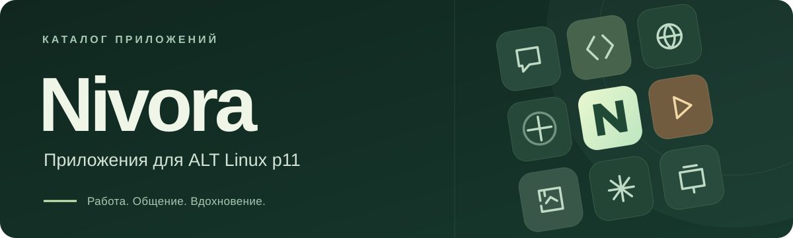
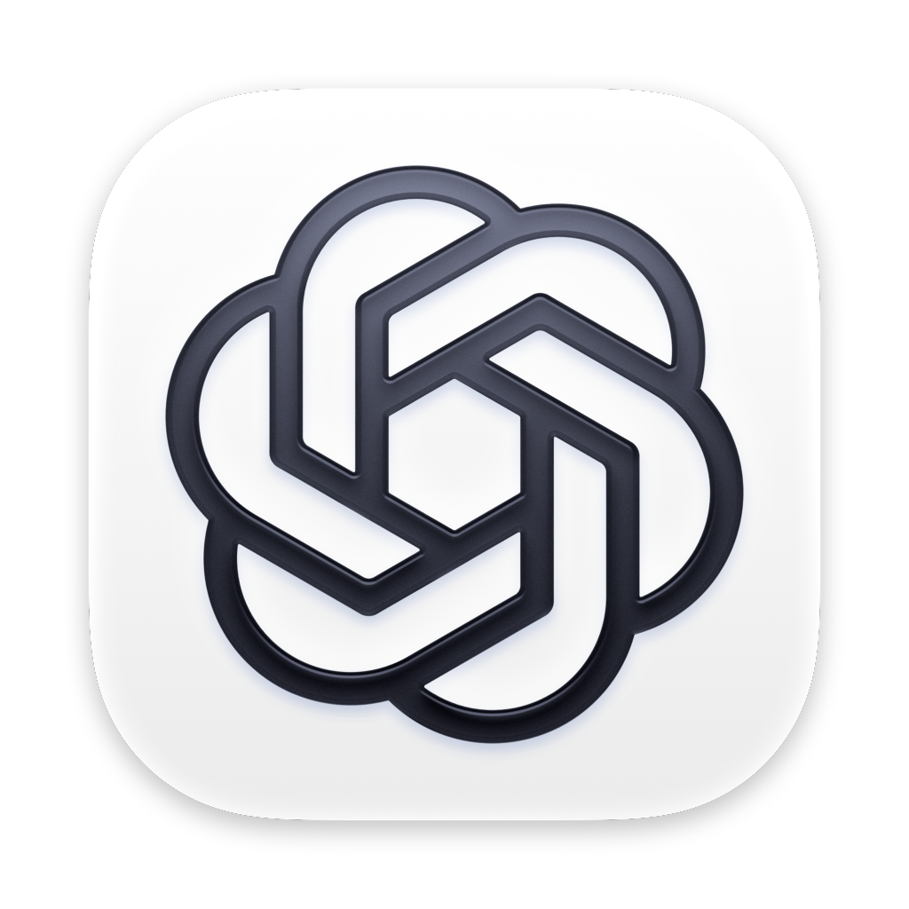

  

  Ваши приложения на <strong>ALT Linux p11</strong>. 
  Выберите нужное — установите через Stapler.

  <a href=".github/docs/installation.md"><strong>Подключить каталог →</strong></a> &nbsp;·&nbsp;
  <a href="#каталог">Выбрать приложение</a> &nbsp;·&nbsp;
  <a href=".github/docs/installation.md#если-возникла-ошибка">Помощь</a>

<!-- package-count -->

<strong>12 приложений</strong> &nbsp;·&nbsp; 4 категории

## Каталог

[AI и разработка](#ai-и-разработка) &nbsp; / &nbsp;
[Интернет и сеть](#интернет-сеть-и-vpn) &nbsp; / &nbsp;
[Медиа и игры](#медиа-и-игры) &nbsp; / &nbsp;
[Инструменты](#системные-инструменты)

<!-- catalog:start -->

## AI и разработка

<table width="100%">
  <tr>
    <td width="50%" valign="top">
      <!-- package-card:antigravity -->
      

      <h3><a href="antigravity/README.md">Google Antigravity App</a></h3>
      
ИИ-агенты Google для ваших проектов. Ведите несколько задач и разговоров параллельно.

      <!-- package-meta:antigravity -->
      
Версия <code>2.34.0</code> · <code>amd64</code> <code>arm64</code>

      <!-- /package-meta:antigravity -->
      
<a href="antigravity/README.md#установка"><strong>Установить →</strong></a> &nbsp;·&nbsp; <a href="https://antigravity.google/download/">Сайт</a>

    </td>
    <td width="50%" valign="top">
      <!-- package-card:chatgpt -->
      

      <h3><a href="chatgpt/README.md">ChatGPT</a></h3>
      
Чат, файлы и проекты в настольном приложении OpenAI. Встроенный Codex помогает работать с кодом.

      <!-- package-meta:chatgpt -->
      
Версия <code>26.1117.31558</code> · <code>amd64</code> <code>arm64</code>

      <!-- /package-meta:chatgpt -->
      
<a href="chatgpt/README.md#установка"><strong>Установить →</strong></a> &nbsp;·&nbsp; <a href="https://learn.chatgpt.com/docs/app">Сайт</a>

    </td>
  </tr>
  <tr>
    <td width="50%" valign="top">
      <!-- package-card:claude -->
      

      <h3><a href="claude/README.md">Claude</a></h3>
      
Чат Claude, Cowork и Claude Code в одном приложении Anthropic. Для текста, файлов и работы над кодом.

      <!-- package-meta:claude -->
      
Версия <code>6.28899.2</code> · <code>amd64</code> <code>arm64</code>

      <!-- /package-meta:claude -->
      
<a href="claude/README.md#установка"><strong>Установить →</strong></a> &nbsp;·&nbsp; <a href="https://code.claude.com/docs/en/desktop-linux">Сайт</a>

    </td>
    <td width="50%" valign="top">
      <!-- package-card:opencode -->
      

      <h3><a href="opencode/README.md">OpenCode</a></h3>
      
Открытый ИИ-агент для разработки. Выбирайте провайдера моделей и ведите несколько сессий над проектом.

      <!-- package-meta:opencode -->
      
Версия <code>2.3.2</code> · <code>amd64</code> <code>arm64</code>

      <!-- /package-meta:opencode -->
      
<a href="opencode/README.md#установка"><strong>Установить →</strong></a> &nbsp;·&nbsp; <a href="https://opencode.ai">Сайт</a>

    </td>
  </tr>
</table>

## Интернет, сеть и VPN

<table width="100%">
  <tr>
    <td width="50%" valign="top">
      <!-- package-card:happ -->
      

      <h3><a href="happ/README.md">Happ</a></h3>
      
Прокси-клиент на основе Xray. Добавьте подписку или файл настроек для доступа к своим серверам.

      <!-- package-meta:happ -->
      
Версия <code>4.8.3</code> · <code>amd64</code> <code>arm64</code>

      <!-- /package-meta:happ -->
      
<a href="happ/README.md#установка"><strong>Установить →</strong></a> &nbsp;·&nbsp; <a href="https://happ.info/">Сайт</a>

    </td>
    <td width="50%" valign="top">
      <!-- package-card:tailscale -->
      

      <h3><a href="tailscale/README.md">Tailscale</a></h3>
      
Частная сеть для ваших устройств на базе WireGuard. В Linux — через командную строку.

      <!-- package-meta:tailscale -->
      
Версия <code>1.104.7</code> · <code>amd64</code> <code>arm64</code>

      <!-- /package-meta:tailscale -->
      
<a href="tailscale/README.md#установка"><strong>Установить →</strong></a> &nbsp;·&nbsp; <a href="https://tailscale.com">Сайт</a>

    </td>
  </tr>
  <tr>
    <td colspan="2" valign="top">
      <!-- package-card:telegram -->
      

      <h3><a href="telegram/README.md">Telegram Desktop</a></h3>
      
Сообщения, группы, каналы и обмен файлами на компьютере. Переписка синхронизируется с другими устройствами.

      <!-- package-meta:telegram -->
      
Версия <code>7.4.4</code> · <code>amd64</code>

      <!-- /package-meta:telegram -->
      
<a href="telegram/README.md#установка"><strong>Установить →</strong></a> &nbsp;·&nbsp; <a href="https://desktop.telegram.org/">Сайт</a>

    </td>
  </tr>
</table>

## Медиа и игры

<table width="100%">
  <tr>
    <td width="50%" valign="top">
      <!-- package-card:anidesk -->
      

      <h3><a href="anidesk/README.md">AniDesk</a></h3>
      
Клиент Anixart от сообщества. Открытый код, видеоплеер и улучшение видео через Anime4K.

      <!-- package-meta:anidesk -->
      
Версия <code>0.0.1-beta.7</code> · <code>amd64</code>

      <!-- /package-meta:anidesk -->
      
<a href="anidesk/README.md#установка"><strong>Установить →</strong></a> &nbsp;·&nbsp; <a href="https://github.com/theDesConnet/AniDesk">Сайт</a>

    </td>
    <td width="50%" valign="top">
      <!-- package-card:parsec -->
      

      <h3><a href="parsec/README.md">Parsec</a></h3>
      
Удалённый рабочий стол с низкой задержкой. Доступ с Linux к компьютеру-хосту для работы и игр.

      <!-- package-meta:parsec -->
      
Версия <code>150-104a</code> · <code>amd64</code>

      <!-- /package-meta:parsec -->
      
<a href="parsec/README.md#установка"><strong>Установить →</strong></a> &nbsp;·&nbsp; <a href="https://parsec.app/downloads">Сайт</a>

    </td>
  </tr>
  <tr>
    <td width="50%" valign="top">
      <!-- package-card:pineconemc -->
      

      <h3><a href="pineconemc/README.md">Pinecone&#8203;MC</a></h3>
      
Лаунчер Minecraft на основе Prism Launcher. Управляйте сборками, модами и модпаками, входите через Ely.by.

      <!-- package-meta:pineconemc -->
      
Версия <code>11.1.2</code> · <code>amd64</code> <code>arm64</code>

      <!-- /package-meta:pineconemc -->
      
<a href="pineconemc/README.md#установка"><strong>Установить →</strong></a> &nbsp;·&nbsp; <a href="https://elyprismlauncher.github.io/">Сайт</a>

    </td>
    <td width="50%" valign="top">
      <!-- package-card:yandex-music -->
      

      <h3><a href="yandex-music/README.md">Яндекс Музыка</a></h3>
      
Музыка, «Моя волна» и подборки на ваш вкус в приложении Яндекса.

      <!-- package-meta:yandex-music -->
      
Версия <code>5.128.0</code> · <code>amd64</code>

      <!-- /package-meta:yandex-music -->
      
<a href="yandex-music/README.md#установка"><strong>Установить →</strong></a> &nbsp;·&nbsp; <a href="https://music.yandex.ru/download/">Сайт</a>

    </td>
  </tr>
</table>

## Системные инструменты

<table width="100%">
  <tr>
    <td colspan="2" valign="top">
      <!-- package-card:balena-etcher -->
      

      <h3><a href="balena-etcher/README.md">balenaEtcher</a></h3>
      
Запись образов операционных систем на USB-накопители и SD-карты. Выбор образа, выбор устройства и проверка результата.

      <!-- package-meta:balena-etcher -->
      
Версия <code>2.1.9</code> · <code>amd64</code>

      <!-- /package-meta:balena-etcher -->
      
<a href="balena-etcher/README.md#установка"><strong>Установить →</strong></a> &nbsp;·&nbsp; <a href="https://etcher.balena.io/">Сайт</a>

    </td>
  </tr>
</table>
<!-- catalog:end -->

---

**Выбрали приложение?** Откройте его карточку — внутри описание, особенности и команда установки.
Для первого знакомства начните с [подключения каталога](.github/docs/installation.md).

<code>amd64</code> — x86_64 · <code>arm64</code> — AArch64 с предварительной поддержкой.
<a href=".github/docs/installation.md#платформа-и-архитектуры">Подробнее об архитектурах</a>.

Nivora — независимый каталог сообщества. Описания основаны на материалах разработчиков;
ссылка «Сайт» в каждой карточке ведёт к первоисточнику. Условия использования приложений
и доступ к их сервисам определяют разработчики.
