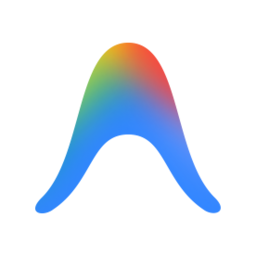

<p align="center">
  
</p>

<h1 align="center">Antigravity</h1>

<p align="center">
  Десктопное приложение Google Antigravity
</p>

<p align="center">
  <a href="LICENSE"></a>
  
</p>

---

## Установка

```bash
sudo stplr refresh
sudo stplr install nivora/antigravity
```

Поддерживаются ALT Linux p11 и Sisyphus, архитектуры amd64 и arm64.
Пакет скачивает официальный архив **Antigravity App** непосредственно у Google.
Отдельный продукт Antigravity IDE в этот пакет не входит.

Для работы нужна учётная запись Google и доступ к сервису. Настройки,
авторизация и рабочие данные хранятся в штатном пользовательском профиле
приложения; обновление и удаление RPM его не затрагивают.

## Запуск и интеграция с рабочим столом

| Назначение | Путь или идентификатор |
|---|---|
| Приложение | `/opt/antigravity` |
| Команда запуска | `/usr/bin/antigravity` |
| Единственный ярлык меню, Wayland и OAuth | `antigravity.desktop` |
| Компонент GNOME Software | `com.google.Antigravity` |
| Обработчик ссылки входа | `antigravity://` |

Имя desktop-файла соответствует имени, которое задаёт сам Electron.
Карточка GNOME Software ссылается на этот же ярлык; отдельного второго
приложения в меню нет. Launcher передаёт аргументы без преобразования и
очищает `APPIMAGE`, `APPDIR` и `ELECTRON_RUN_AS_NODE`, чтобы запуск из другого
Electron-приложения или AppImage не менял поведение установленного пакета.

Chromium sandbox сохранён: пакет устанавливает штатный `chrome-sandbox`
с правами `4755`. Параметр `--no-sandbox` не добавляется.

### Переход с release 1–5

Начиная с release 6 RPM удаляет дублирующий `com.google.Antigravity.desktop`.
Если в избранном остался прежний ярлык, удалите его из панели, запустите
Antigravity из меню и закрепите работающий значок заново.

После первого запуска приложение регистрирует обработчик `antigravity://`
в пользовательском сеансе. Если браузер продолжает предлагать старую
ассоциацию, выполните **от своего пользователя, без sudo**:

```bash
xdg-mime default antigravity.desktop x-scheme-handler/antigravity
xdg-mime query default x-scheme-handler/antigravity
```

Ожидаемый результат второй команды — `antigravity.desktop`. Затем повторите
вход из приложения. Запрос браузера на разрешение открыть внешнее приложение
может оставаться: его настройки пакет не меняет.

## Обновления

```bash
sudo stplr refresh
sudo stplr upgrade
```

Обновления приложения выполняются через Stapler. Конфигурация встроенного
updater не устанавливается; launcher исключает режим AppImage. Сам код и
пункты меню upstream updater не переписываются.

Рецепт фиксирует полный build ID Google, а не только номер версии.
Updater выбирает согласованные официальные ссылки для обеих архитектур,
проверяет их доступность и атомарно обновляет версию, build ID и SHA-256.
Повторная upstream-сборка той же версии повышает `release`.

При сборке проверяются архитектура бинарников и корневой `package.json`
в `app.asar`: версия, имя приложения, desktop identity и точка входа.
Совпадение версии какой-либо вложенной зависимости проверку не заменяет.

## Проверки

```bash
bash antigravity/tests/test-package.sh
bash antigravity/tests/test-desktop-integration.sh
```

Эти проверки выполняют рецепт на небольших архивах обеих архитектур,
проверяют готовые пути, desktop/AppStream, права sandbox, список файлов и
передачу аргументов launcher. Общий CI дополнительно собирает RPM и проверяет
установку, обновление и удаление в ALT p11 и Sisyphus на amd64.
ARM64 не имеет отдельного CI runner. Вход в Google и поведение окна в
пользовательском графическом сеансе требуют проверки на рабочей системе.

---

<p align="center">
  Часть <a href="../README.md"><b>Nivora</b></a>
</p>
