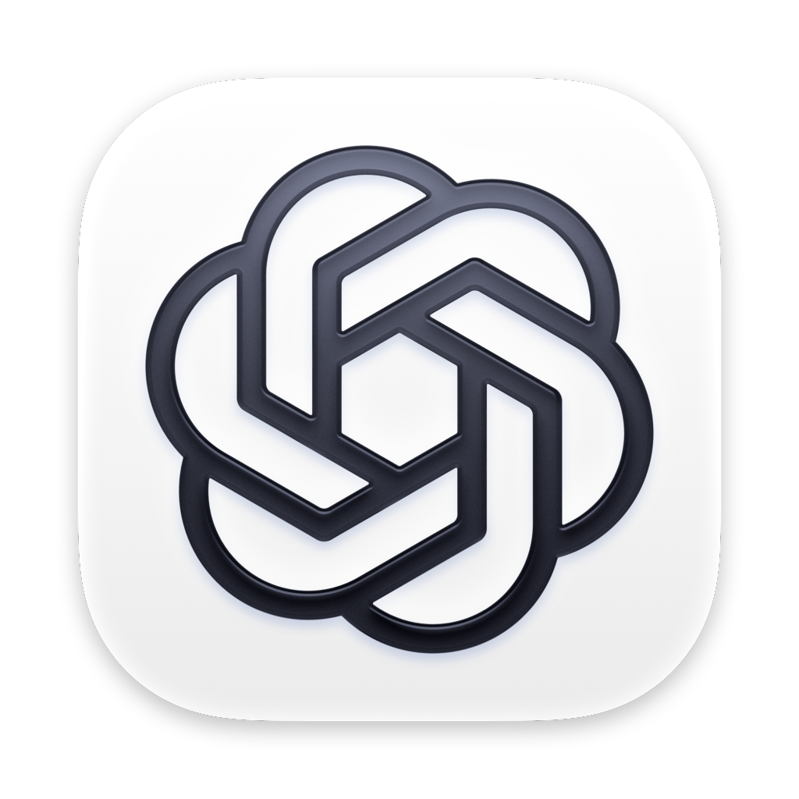

<p align="center">
  
</p>

# ChatGPT

Официальное настольное приложение OpenAI для общения с ChatGPT, работы с файлами и проектами. Встроенный Codex помогает выполнять задачи по разработке.

[Официальный сайт и описание](https://learn.chatgpt.com/docs/app) · [Лицензия](LICENSE)

**Платформа:** ALT Linux p11.

**Архитектуры:** amd64 · arm64 (предварительная поддержка).

## Установка

Сначала [подключите Nivora](../.github/docs/installation.md#2-подключить-nivora),
затем выполните:

```bash
sudo stplr install nivora/chatgpt
```

Текущая версия указана в [каталоге](../README.md#каталог).
[Обновление и удаление](../.github/docs/installation.md) выполняются через Stapler.

## Запуск

Откройте приложение из меню или выполните от своего пользователя:

```bash
chatgpt
```

Доступные функции зависят от учётной записи и тарифа OpenAI.

[Каталог Nivora](../README.md) · [Помощь](../.github/docs/troubleshooting.md)
