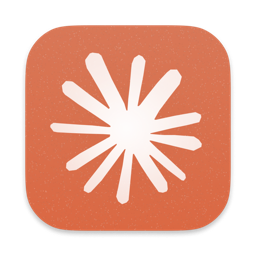

<p align="center">
  
</p>

# Claude

Официальное настольное приложение Anthropic объединяет чат Claude, Cowork и Claude Code. В интерфейсе доступны параллельные сессии, просмотр изменений, терминал и редактор.

[Официальный сайт и описание](https://code.claude.com/docs/en/desktop-linux) · [Лицензия](LICENSE)

**Платформа:** ALT Linux p11.

**Архитектуры:** amd64 · arm64 (предварительная поддержка).

## Установка

Сначала [подключите Nivora](../.github/docs/installation.md#2-подключить-nivora),
затем выполните:

```bash
sudo stplr install nivora/claude
```

Текущая версия указана в [каталоге](../README.md#каталог).
[Обновление и удаление](../.github/docs/installation.md) выполняются через Stapler.

## Запуск

Откройте приложение из меню или выполните от своего пользователя:

```bash
claude-desktop
```

Версия для Linux у разработчика обозначена как beta. Для Cowork нужна аппаратная виртуализация; подробности — в [официальных требованиях](https://code.claude.com/docs/en/desktop-linux#cowork-requirements). Доступность функций зависит от тарифного плана.

[Каталог Nivora](../README.md) · [Помощь](../.github/docs/troubleshooting.md)
